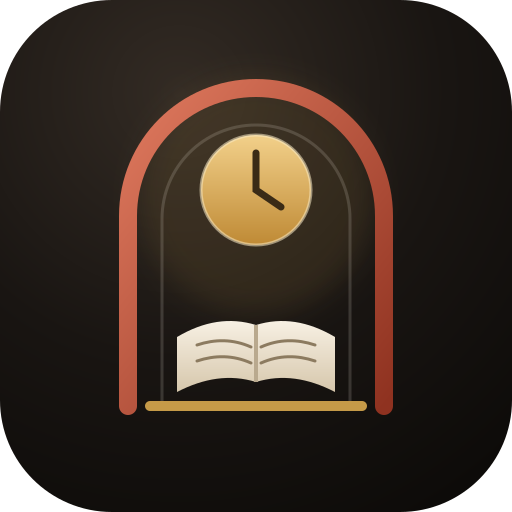
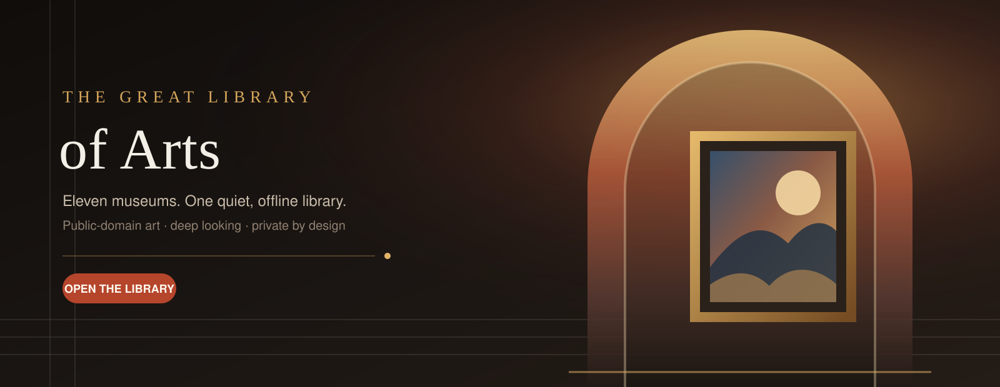

<div align="center">

<br/>
<br/>



# The Great Library of Arts

### Look. Linger. Learn.

**An offline-first Android museum for public-domain art, built for slow attention and private discovery.**

<br/>

[](https://github.com/fleurdeur/The-Library-Of-Arts/releases)
[](https://github.com/fleurdeur/The-Library-Of-Arts/blob/main/LICENSE)
[](https://github.com/fleurdeur/The-Library-Of-Arts/releases)
[](https://github.com/fleurdeur/The-Library-Of-Arts/releases)

<br/>

[**Download**](#download) · [**Features**](#features) · [**Museums**](#museums) · [**Your Eyes First**](#eyes-first) · [**Offline packs**](#offline) · [**Performance**](#performance) · [**Build**](#build) · [**Privacy**](#privacy) · [**Credits**](#credits)

<br/>



</div>

> [!IMPORTANT]
> The Great Library of Arts is an independent, non-commercial project. It is not affiliated with any museum, gallery, publisher or image service. Artwork metadata belongs to the holding institutions; every record keeps its licence, credit line and provenance. Only use images and media you have the right to use.

---

<div align="center">

<h1><a id="features"></a>Features</h1>

<table>
  <tr>
    <td width="50%" valign="top">

#### A museum in your pocket
- **Twelve sources** normalized into one Artwork model, including Google Arts & Culture discovery.
- **A printed-catalogue interface** — serif titles, full-bleed plates, hairline rules and generous margins, not glass cards or template dashboards.
- **Daily hero work** with genre rows, Continue exploring, Because you viewed, On this day and Trending.
- **On-device taste profile** with 45-day interest decay, muted interests, pinned interests and a discovery reserve.
- **Plain-language reasons** for every recommendation, with no hidden weights.
- **Taste Profile screen** to see, adjust or reset everything the library has noticed.
- **Licence, credit and provenance** shown on every artwork.
- **In-app edition updates** — checks the GitHub API, then the public Atom feed, then a bundled JSON mirror; notifies you once per edition and installs the APK that fits the device.

    </td>
    <td width="50%" valign="top">

#### Look closer
- **Technical lens**: infrared, X-ray, underdrawing, before-restoration and after-restoration readings over any plate.
- **Endless looking games** generated from installed works, with level-based difficulty, bigger option sets, tighter detail crops and real artwork images.
- **Detail hunt** asks which work a cropped detail belongs to; **Spot the fake** shows a plate and asks you to find the true label.

#### Explore without a signal
- **FTS5 search** across titles, artists, descriptions, tags and moods.
- **Filters** for genre, period, museum, medium, mood, subject, colour and sort order.
- **A drawn Natural Earth museum atlas** with real coastlines, graticule, compass and its own museum notes, with no tile server.
- **Time Machine**, **Colour Search**, **Similar Art**, **Hidden Gems**, **Artist Connections** and **Museum Visit**.
- **Offline floor guides** and museum audio stops.
- **Seed library** installed with the app, so every screen works from first launch.
- **Technical study lenses** for infrared, X-ray, underdrawing and before/after restoration readings, clearly marked as interpretive filters rather than museum imaging.
- **Fast, lazy plates** — Coil keeps a 256 MB disk cache; cards show an immediately cached thumbnail while the full painting fades in behind it. Home reaches the network only on a deliberate pull-to-refresh.

    </td>
  </tr>
</table>

<table>
  <tr>
    <td width="50%" valign="top">

#### Looking closely
- **Deep-zoom viewer** with pan, zoom and tile-aware images.
- **Brushstroke, Slow Looking, Hidden Details and X-ray / infrared / restoration layers** when a pack supplies them.
- **Frame Preview** and **Scale Check**.
- **Narration** through Media3, with a TTS fallback.
- **Share cards** rendered on-device.
- **Private Journal** with search, tags, moods and a timeline.
- **PDF virtual exhibitions** and collection export/import.

    </td>
    <td width="50%" valign="top">

#### Learn and play
- **Story Tours** and **Art School** lessons.
- **Glossary** and artist biographies.
- **Spaced-repetition flashcards** with honest, gentle scheduling.
- **Draw This, Detail Hunt, Daily Quiz, Guess the Artist, Spot the Fake**.
- **Compare mode** and **mood discovery**.
- **Offline Scan a Painting** with perceptual hashes.
- **Kids Mode** with large pictures and simple prompts.

    </td>
  </tr>
</table>

</div>

---

<div align="center">

<h1><a id="museums"></a>Twelve sources</h1>

</div>

Every source is mapped into the same immutable model, so search, packs, backups and recommendations never care where a work came from.

| Museum | API | Notes |
| :--- | :--- | :--- |
| The Metropolitan Museum of Art | Collection API | Degrades gracefully when unavailable |
| Art Institute of Chicago | Art Institute API | Public-domain filter |
| Rijksmuseum | Rijksmuseum API | Key optional |
| Cleveland Museum of Art | Open Access API | CC0 filter |
| Smithsonian | Open Access API | Key optional |
| National Gallery of Art | NGA API | Key optional |
| Europeana | Search API | Key optional |
| Harvard Art Museums | API | Key optional |
| Paris Musées | Collections API | Key optional |
| Getty | Museum API | Key optional |
| Wikimedia Commons | MediaWiki API | Rate-limit aware thumbnails |
| Google Arts & Culture | Public painting index | Discovery only; rights stay with the holding collection |

No API key is committed. Keyless sources (The Met, Art Institute, Cleveland, NGA, Wikimedia, Google Arts & Culture) work immediately; key-gated adapters stay disabled until configured through `SourceCredentials`. Google Arts & Culture records are always marked **verify source rights** rather than claimed as public domain. The seed library and every offline feature work without any key.

---

<div align="center">

<h1><a id="eyes-first"></a>Your Eyes First</h1>

</div>

The interpretation feature belongs to you, not to a cloud service.

<table>
  <tr>
    <td width="50%" valign="top">

#### On-device reading

- **Rule-based description engine** that names what is visible without inventing a story.
- **Optional local model pack** for richer language; if it is absent, the deterministic path is used.
- **Voice dictation** into the Journal through the platform speech recogniser.
- **No image, note or taste signal** is uploaded.

    </td>
    <td width="50%" valign="top">

#### Private by construction

- **Encrypted Room database** with a random passphrase wrapped in the Android Keystore.
- **Opt-in crash reporting**, off by default and free of artwork, journal text and location.
- **No account, advertising SDK, analytics SDK or attribution SDK.**
- **Location used once** on Museum Visit and never stored.

    </td>
  </tr>
</table>

---

<div align="center">

<h1><a id="offline"></a>Offline packs</h1>

</div>

Six real packs are published on the **[packs-v1 release](https://github.com/fleurdeur/The-Library-Of-Arts/releases/tag/packs-v1)**. They contain the JSONL index, public-domain image files and checksums the installer verifies.

- **Resumable HTTP range downloads**, with progress and cancellation.
- **Mandatory SHA-256 verification** before extraction.
- **Optional ECDSA P-256 signature verification** through `PackTrust`.
- **Zip-slip and path traversal rejection**, plus entry and size limits.
- **Free-space checks** before download and extraction.
- **Room indexing** after install, and clean pack deletion.
- **Delta metadata support** for future updates.
- **Public release downloads** — no private CDN or account is required.
- **Images and metadata travel inside every pack**, matched by source id even when the archive uses a different image extension.
- **Published now:** *Starter Salon* (23 works), *Impressionism & After* (6 works), *Dutch Golden Age* (7 works), *The Landscape Room* (8 works), *Portraits & Presences* (10 works) and *Rooms & Shadows* (7 works). Install them from Settings → Offline packs; each archive is checksum-pinned in the app, and an installed pack appears only once.

The starter pack replaces the built-in seed records with local image copies, so the same plates work with the radio off. Pack deletion is clean and never removes journal entries or collections.

---

<div align="center">

<h1><a id="performance"></a>Performance</h1>

</div>

- **Lazy lists and Paged search** everywhere; no full-collection loads.
- **Coil disk and memory caching**, size-aware requests, and no eager preloading with data saver on.
- **Stable Compose types**, strong skipping and immutable UI state.
- **R8 full mode** and resource shrinking for release.
- **Baseline profile support** through `androidx.profileinstaller`, with a Macrobenchmark generator in `baselineprofile/`.
- **Adaptive navigation** — bottom bar on phones, navigation rail on wide screens.
- **Offline-first repositories**; network failure never blocks the library.

---

<div align="center">

<h1><a id="download"></a>Download</h1>

<a href="https://github.com/fleurdeur/The-Library-Of-Arts/releases" target="_blank" rel="noopener noreferrer"></a>

Grab the latest signed APK from **[Releases](https://github.com/fleurdeur/The-Library-Of-Arts/releases)**, or open **Settings → Updates** inside the app to check, choose the edition for this device, download it and install it. The downloaded APK is removed after the new version is installed.

| Package | Best for | Size |
| :--- | :--- | ---: |
| **Universal APK** | Any phone or tablet — choose this if unsure | ~23 MB |
| **ARM64 APK** | Most modern phones and tablets (arm64-v8a) | ~16 MB |
| **ARMv7 APK** | Older 32-bit phones and tablets (armeabi-v7a) | ~15 MB |
| **Wear APK** | Wear OS 3.0+ companion | ~9 MB |

**Requirements:** Android 8.0 (API 26) or newer, a device with 2 GB RAM or more, and roughly 150 MB free for the seed library and image cache. Optional features — camera scan, location, narration, AR wall preview — ask for permission only when opened.

</div>

---

<div align="center">

<h1><a id="build"></a>Build</h1>

```bash
git clone https://github.com/fleurdeur/The-Library-Of-Arts.git
cd The-Library-Of-Arts

# Debug APKs for phone and Wear
./gradlew assembleDebug

# Signed release (requires your own keystore.properties)
./gradlew :app:assembleRelease :wear:assembleRelease
```

**Toolchain**

- Android SDK 37 / build-tools 36+
- JDK 17 or newer (CI uses 21)
- Gradle 9.8.2
- AGP 9.4.1 with built-in Kotlin 2.4.21
- Compose BOM 2026.09.00
- KSP 2.3.14 · Hilt 2.60.1

Create an untracked `local.properties` with `sdk.dir=/absolute/path/to/Android/Sdk`. Signing uses an untracked `keystore.properties`; neither file, nor any keystore, is part of the repository.

**Quality**

```bash
./gradlew testDebugUnitTest
./gradlew lintDebug
```

Unit tests cover the recommendation engine, seed integrity, encryption round-trips and database entities. GitHub Actions builds, lints and tests every push.

</div>

---

<div align="center">

<h1>Project layout</h1>

</div>

```text
app/                     Application, navigation, workers, widget, tile, wallpaper,
                         daydream, Cast options, AR wall preview
build-logic/             Convention plugins for application, library, Compose and Hilt
core/
  common/                Result types, dates, crypto, connectivity, feature flags, dHash
  model/                 Normalized artwork, museum, learning, journal, collection, taste, pack
  designsystem/          Catalogue theme, serif/Inter type, rules, haptics, bundled fonts
  database/              Room + SQLCipher, FTS5, DAOs, encrypted key handling
  network/               Retrofit + Serialization, twelve sources, Google Arts discovery, health
  datastore/             Preferences and typed settings
  data/                  Repositories, seed library, recommender, packs, backup, PDF/share
  media/                 Media3 playback service and TTS narrator
  ui/                    Shared artwork cards, image loading, screen primitives
feature/
  home/ explore/ artwork/ journal/ taste/ collections/ learn/ games/ settings/
wear/                    Wear OS companion
baselineprofile/         Macrobenchmark baseline-profile generator
docs/                    Repository artwork
```

The repository excludes generated build output, APKs, keystores, local SDK paths, API keys and AI model files. Signed APKs are attached to releases.

---

<div align="center">

<h1><a id="privacy"></a>Privacy</h1>

</div>

- **No account.** Nothing to sign in to.
- **No ads.** No advertising or attribution SDK.
- **No analytics.** The library does not phone home.
- **No cloud requirement.** The seed collection, journal, learning, games and packs work offline.
- **Museum requests** go only to the museum being browsed, with no user identifier attached.
- **Camera frames** used by Scan and the wall preview are processed locally and discarded.
- **Encrypted backup** is opt-in, written through the Storage Access Framework, and uses AES-256-GCM with a passphrase that is never stored.
- **Android cloud backup is disabled** for app data.

The in-app privacy dashboard restates every control and its current state.

---

<div align="center">

<h1>Notes</h1>

</div>

- The Met endpoint currently answers HTTP 410. The source is isolated behind health tracking; the rest of the library continues to work.
- Wikimedia Commons enforces rate limits. The app uses thumbnail URLs and backs off rather than hammering the API.
- **AR wall preview** is a camera-and-frame scale preview with an ARCore capability check. Depth-aware plane placement is deliberately not faked.
- **Cast** ships with receiver options and a manifest entry; the in-app gallery casting UI is not exposed yet.
- Museum prose remains in the language supplied by the source. The UI scaffolding supports eleven languages and RTL.

---

<div align="center">

<h1><a id="credits"></a>Credits</h1>

</div>

**The Great Library of Arts** is built with Kotlin, Jetpack Compose and AndroidX, and stands on the work of the museums and open-source projects that make public-domain art available to everyone.

Special thanks to:

- **The Metropolitan Museum of Art, Art Institute of Chicago, Rijksmuseum, Cleveland Museum of Art, Smithsonian, National Gallery of Art, Europeana, Harvard Art Museums, Paris Musées, Getty and Wikimedia Commons** — for open collections and machine-readable metadata.
- **Inter** — the UI typeface, under the SIL Open Font License.
- **Noto Color Emoji** — under the SIL Open Font License.
- **AndroidX, Kotlin, Coil, Retrofit, OkHttp, Room, Hilt, Media3 and SQLCipher** — the foundations.
- **Every museum curator, photographer and cataloguer** whose credit line appears beside a work.

Artwork images are not covered by this project's licence. Each record keeps the licence and credit supplied by its institution.

---

<div align="center">

<h1>Free and open</h1>

The Great Library of Arts has **no paywall, no account requirement and no locked art**. If you use it, keep the credits and share what you notice.

</div>

---

<div align="center">

<h1>License</h1>

This project is licensed under the **GNU General Public License v3.0 (GPLv3)**. See the [LICENSE](LICENSE) file for details.

</div>
